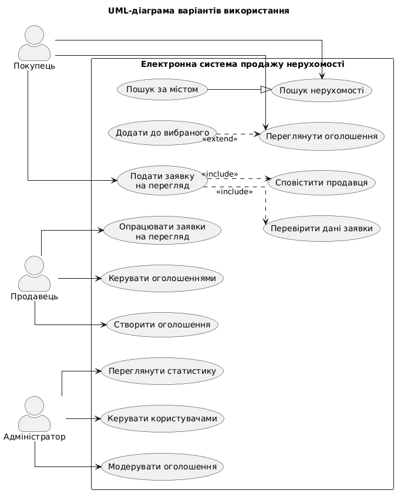
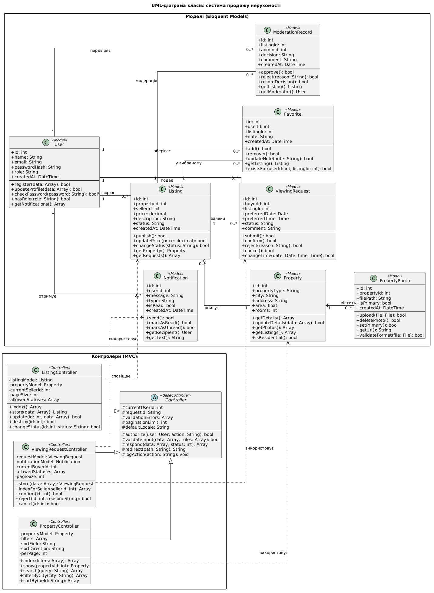

# Електронна система продажу нерухомості

## 1. Опис системи

Електронна система продажу нерухомості — це вебзастосунок, призначений для автоматизації розміщення, пошуку та перегляду оголошень про продаж об'єктів нерухомості.

Система розробляється з використанням PHP-фреймворку Laravel на основі архітектурного шаблону MVC (Model–View–Controller). Для зберігання даних передбачається використання MySQL.

### Основні функції

- Реєстрація та авторизація користувачів.
- Розміщення оголошень про продаж нерухомості.
- Пошук і фільтрація об'єктів.
- Перегляд характеристик та фотографій нерухомості.
- Редагування та видалення власних оголошень.
- Подання заявок на перегляд нерухомості.
- Додавання оголошень до списку вибраного.
- Модерація оголошень та керування користувачами.

### Користувачі системи

1. **Покупець** — здійснює пошук нерухомості, переглядає оголошення та подає заявки.
2. **Продавець** — створює оголошення, керує ними та опрацьовує заявки.
3. **Адміністратор** — модерує оголошення, керує користувачами та переглядає статистику.

### Основні сутності

User, Property, Listing, PropertyPhoto, Favorite, ViewingRequest, Notification, ModerationRecord.

## 2. Use Case: Подання заявки на перегляд нерухомості

**Use Case Name:** Подати заявку на перегляд нерухомості.

**Scope:** Електронна система продажу нерухомості (System).

**Level:** User-goal.

**Primary Actor:** Покупець.

### Stakeholders and Interests

- **Покупець:** зацікавлений у зручному поданні заявки та отриманні відповіді продавця.
- **Продавець:** зацікавлений в отриманні й опрацюванні заявок.
- **Адміністратор:** забезпечує контроль дотримання правил системи.

### Preconditions

- Покупець зареєстрований та авторизований.
- Оголошення про нерухомість є активним.
- Система доступна для виконання операцій.

### Success Guarantee

Заявку збережено в базі даних зі статусом «Очікує підтвердження». Продавцю сформовано сповіщення, а покупець отримав підтвердження подання заявки.

### Main Success Scenario

1. Покупець відкриває вебсайт.
2. Переходить до каталогу нерухомості.
3. Система відображає активні оголошення.
4. Покупець обирає об'єкт нерухомості.
5. Система відображає характеристики об'єкта та кнопку подання заявки.
6. Покупець натискає «Подати заявку на перегляд».
7. Система перевіряє авторизацію та доступність оголошення й відкриває форму заявки.
8. Покупець зазначає бажану дату, час та коментар.
9. Покупець підтверджує подання заявки.
10. Система перевіряє коректність даних та відсутність активної дублюючої заявки.
11. Система зберігає заявку в базі даних.
12. Заявці встановлюється статус «Очікує підтвердження».
13. Система формує сповіщення для продавця.
14. Покупець отримує повідомлення про успішне подання заявки.

### Extensions

**7a. Покупець не авторизований**

1. Система пропонує виконати авторизацію.
2. Покупець входить до системи.
3. Повертається до подання заявки.

**7b. Оголошення неактивне**

1. Система виявляє недоступність оголошення.
2. Відображає повідомлення про помилку.
3. Покупець повертається до каталогу.

**10a. Не заповнені обов'язкові поля**

1. Система повідомляє про відсутність необхідних даних.
2. Покупець заповнює поля.
3. Повторно підтверджує заявку.

**10b. Некоректна дата перегляду**

1. Система виявляє минулу дату або час.
2. Покупець отримує повідомлення.
3. Обирає іншу дату та час.

**10c. Існує активна заявка**

1. Система знаходить раніше створену активну заявку.
2. Повідомляє покупця про її існування.
3. Пропонує переглянути поточну заявку.

**11a. Помилка збереження заявки**

1. Система виявляє технічну помилку.
2. Скасовує незавершену операцію.
3. Повідомляє покупця про помилку.
4. Покупець може повторити операцію пізніше.

### Special Requirements

- Захист персональних даних користувачів.
- Доступ до подання заявок лише для авторизованих покупців.
- Адаптивний вебінтерфейс.
- Перевірка коректності введених даних.
- Розмежування прав доступу до заявок.

### Technology and Data Variations List

- Доступ із комп'ютера, планшета або смартфона.
- Вибір дати та часу через поля вебформи.
- Обробка заявок засобами PHP/Laravel.
- Збереження даних у MySQL.

### Frequency of Occurrence

Операція виконується за потреби. Кількісна частота визначатиметься після впровадження системи.

### Miscellaneous

- Можливість зміни дати та часу поданої заявки.
- Додаткові сповіщення електронною поштою.
- Автоматичне скасування заявок без відповіді.

## 3. UML-діаграма варіантів використання

Діаграма відображає основних акторів системи, їхні функціональні можливості та взаємозв'язки між варіантами використання.

## 4. UML-діаграма класів

Діаграма відображає структуру класів електронної системи продажу нерухомості, їхні атрибути, операції та зв'язки між компонентами.

